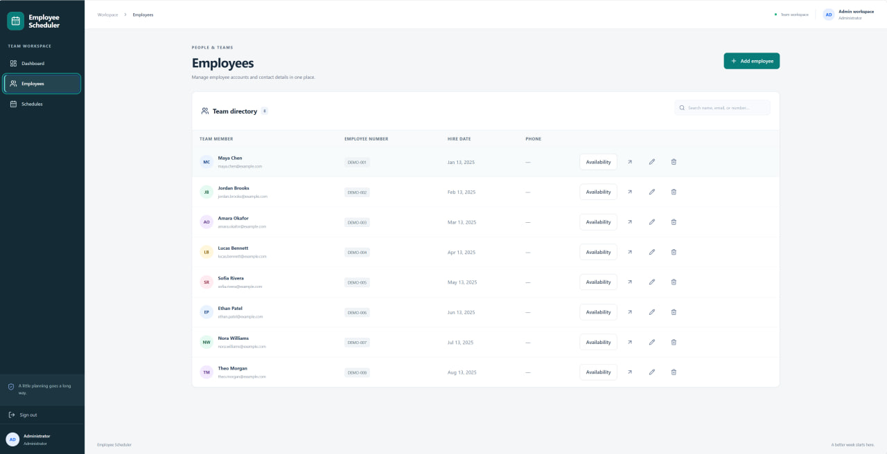
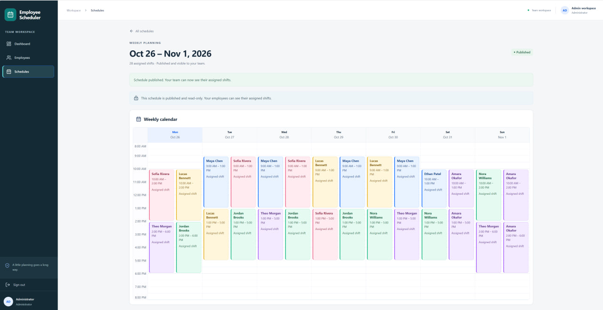
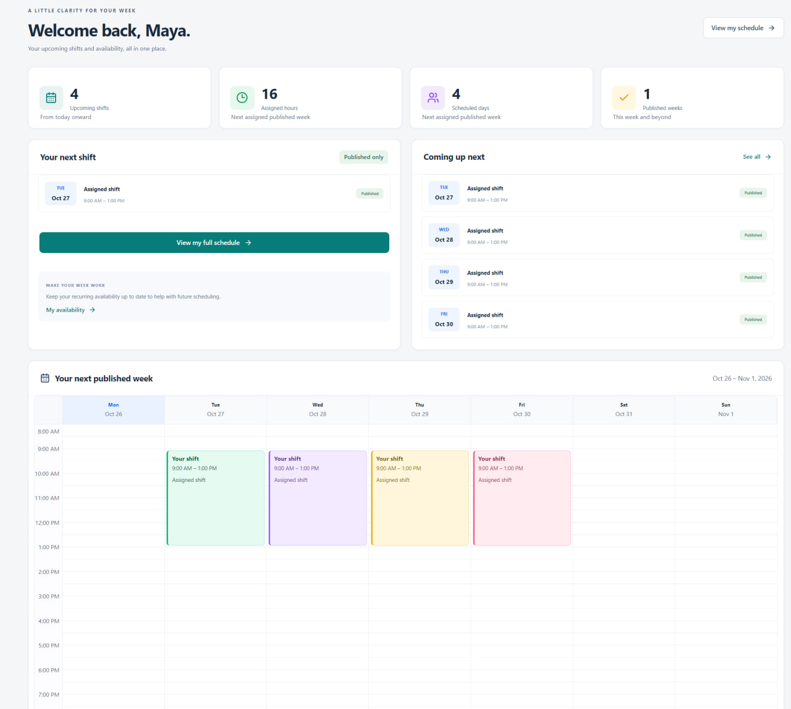
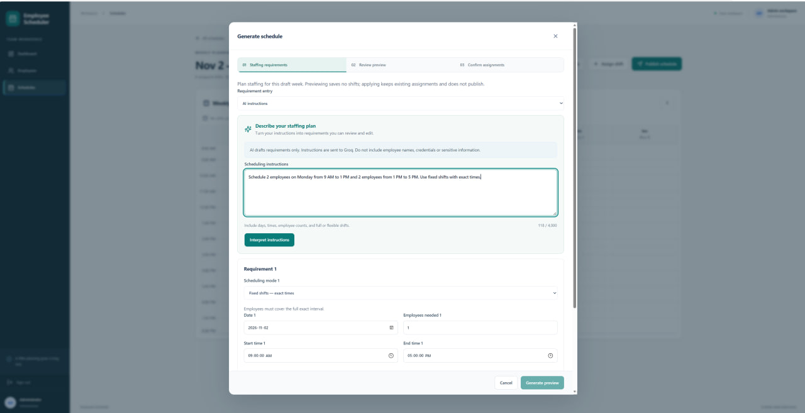
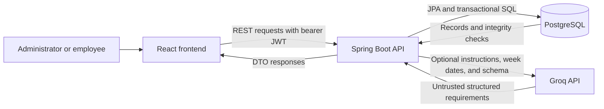

# Employee Scheduler

## Project overview

Employee Scheduler is a full-stack **AI-assisted workforce scheduling application** built with React, Spring Boot, and PostgreSQL. Groq interprets natural-language staffing instructions into structured requirements; a deterministic backend algorithm generates shift suggestions using recorded availability, existing assignments, weekly-hour limits, and an optional fairness preference.

Administrators can also schedule manually. Managers review requirements and generated suggestions, explicitly apply selected shifts to a draft, and publish when ready. Employees use a personal workspace to view their own published shifts and manage recurring availability. AI assists with requirement entry, while assignment decisions and validation remain in the backend.

## Key features

### Administrators

- Manage employee accounts and search the employee directory.
- View individual weekly availability through a read-only dialog.
- Create Monday–Sunday drafts and assign, update, reassign, or delete shifts.
- Generate FIXED/FLEXIBLE suggestions with weekly-hour limits and optional fairness.
- Review calendar previews, workloads, and shortages; apply selected suggestions.
- Convert natural-language instructions into editable requirements using optional Groq integration.
- Publish drafts; view published schedules without editing their assignments.

### Employees

- See their actual name, upcoming shifts, and published-week summaries.
- Browse only their own published assignments in calendar/list views, with date filters.
- Add, edit, or remove one recurring availability interval per weekday.
- Retain valid authentication across page refreshes within the browser tab.

Availability changes do not automatically change assigned shifts. Self-service requests resolve identity from the authenticated user, not a client-selected employee ID.

## Screenshots

A look at the administrator workflow: manage the team, describe staffing needs with AI, and review scheduling results before publication.

### Employee Management

The searchable team directory brings employee profiles and read-only availability access together, with controls for adding and updating employee accounts.



### Published Weekly Schedule

The weekly calendar displays assigned shifts with employee names and individual time ranges. Published status makes the schedule read-only; employees can access their own assignments.



### Employee Dashboard

Employees have a personalized dashboard displaying upcoming shifts, assigned hours, scheduled days, and a weekly calendar of their published assignments.



### AI-Assisted Scheduling

Administrators describe staffing needs in natural language. Groq interprets those instructions into editable requirements; the deterministic backend generates suggestions using availability, existing assignments, hour limits, and the fairness preference. Managers review requirements and previews before explicitly applying shifts and publishing separately.



## Tech stack

| Layer | Technologies |
| --- | --- |
| Frontend | React 19, TypeScript, Vite 8, React Router, TanStack Query, native fetch |
| UI | Tailwind CSS, shared component CSS, Lucide icons, custom weekly calendar |
| Backend | Java 21, Spring Boot 4.1.1, Spring MVC, Spring Data JPA/Hibernate, Maven wrapper |
| Security | Spring Security, signed JWT bearer tokens, BCrypt password hashing |
| Database | PostgreSQL, native GiST exclusion constraints, `btree_gist` |
| Optional AI | Backend Groq HTTP client with strict JSON schema output |
| Verification | JUnit 5, Mockito, PostgreSQL integration tests, Vitest, React Testing Library, ESLint, GitHub Actions |

## Architecture



The backend owns authorization, validation, deterministic generation, and persistence. Groq has no direct database connection or assignment capability. The frontend never receives the provider key.

- `backend/`: controllers, DTOs, services, repositories, security, and database scripts.
- `frontend/src/`: typed API client, shared UI/calendar components, role-specific pages, and tests.
- `docs/`: [automatic scheduling](docs/automatic-scheduling.md), [AI instructions](docs/llm-scheduling.md), and [authentication and availability](docs/authentication-and-availability.md).

## Automatic scheduling

The planner is a **deterministic greedy algorithm**, not a global optimizer. It processes requirements chronologically and checks recorded availability, existing shifts, newly proposed shifts, and the requested weekly-hour cap. Missing availability is never treated as all-day availability.

With fairness enabled, employees with fewer currently assigned seconds are preferred; stable tie-breakers keep identical inputs reproducible. Flexible candidate ranking also considers feasible shift length and start time. Fairness never overrides hard constraints and does not balance historical work across weeks.

Results include proposed assignments, weekly workloads, and explicit shortages. A shortage means this planner could not fill a target under its rules, not that no alternative allocation exists. Existing assignments are preserved, including work already over the requested cap.

Preview writes no shifts to PostgreSQL. Applying selections is transactional, revalidates current data, and rejects stale previews. See [algorithm, concurrency, and token details](docs/automatic-scheduling.md).

## FIXED vs FLEXIBLE

| Behavior | FIXED | FLEXIBLE |
| --- | --- | --- |
| Meaning of 9 AM–5 PM | Exact shift interval | Window in which employees can work |
| Availability for a new shift | Covers the entire 9 AM–5 PM interval | Covers the generated individual interval inside the window |
| Generated times | 9 AM–5 PM for each selected employee | Can be shorter and differ between employees |
| Requested count | Employees covering the exact interval | Distinct employees working sometime in the window |
| Shift-length controls | Exact interval remains unchanged | Configurable minimum/maximum; defaults to 120–480 minutes |

**Example:** request two employees on Monday, 9 AM–5 PM. Employee A is available 9 AM–1 PM; employee B is available 1 PM–5 PM. Assume no existing shifts and enough remaining weekly hours.

- **FIXED:** neither is available for the full interval, so neither receives a new 9 AM–5 PM suggestion; the target remains short by two.
- **FLEXIBLE:** A can receive 9 AM–1 PM and B 1 PM–5 PM, meeting the two-distinct-employee target under default duration settings.

**FLEXIBLE does not guarantee simultaneous staffing or continuous coverage.** A met distinct-worker target says nothing about minimum staffing at every moment. This example does not provide two people throughout the day. Continuous minimum-staffing optimization is not implemented.

## AI-assisted scheduling

Groq converts manager instructions into editable staffing requirements for the selected week. **FIXED** requests exact full-window shifts; **FLEXIBLE** allows individual, potentially shorter shifts within a window. See the [comparison and two-employee example](#fixed-vs-flexible) above.

### Example prompt

Open a draft week, choose **AI instructions** in Generate schedule, and paste:

```text
For the selected week, use FLEXIBLE scheduling and request 2 distinct
employees per day:
- Monday through Friday: 9 AM to 9 PM each day.
- Saturday and Sunday: 10 AM to 6 PM each day.

Employees may work different, shorter shifts within each day's window.
Respect each employee's recorded availability and avoid overlapping their
existing assignments. Cap each employee's total working hours at 40 for
the week, including existing assignments. Distribute hours fairly by
preferring employees with fewer assigned hours in this week.

The daily target is 2 distinct employees working sometime in the window;
it is not a requirement for 2 employees to be on duty at every moment.
```

Review the interpretation for seven FLEXIBLE daily requirements, each requesting two distinct employees, a 40-hour weekly cap, and enabled fairness. Weekdays resolve against the selected schedule. Recorded availability, non-overlap, and the cap are enforced by the deterministic backend, not by Groq. Review the flexible minimum/maximum shift lengths in the form; the prompt does not set them. Existing assignments are preserved rather than shortened to repair an already exceeded cap. Fairness is a greedy preference, not a guarantee of equal hours, and shortages may remain.

**FLEXIBLE does not guarantee simultaneous or continuous staffing coverage.** The prompt's daily count is a distinct-worker target, not a promise to staff every moment of the window.

The AI path follows **interpret → review → preview → apply → publish**: interpret instructions; resolve clarification questions and edit/acknowledge requirements and defaults; generate a preview; review shortages and select suggestions; explicitly apply the selection to the draft; then publish separately. Interpretation and preview save no shifts, and applying does not publish. The [scheduling workflow](#scheduling-workflow) below describes the shared manual and AI review steps.

Missing counts/times or ambiguous modes produce clarification questions. Unsupported constraints are surfaced. Weekly-hour and fairness options stay unset unless explicitly requested.

**The LLM does not optimize schedules, choose employees, assign shifts, or write scheduling records.** The backend validates its untrusted JSON, and the manager reviews it before invoking the deterministic planner. The application sends instructions, selected-week dates, and interpretation rules/schema; it does not attach roster or availability records. Do not include personal information or secrets in instructions.

Without a Groq key, interpretation is unavailable while manual entry and deterministic generation remain usable. See [configuration, examples, safeguards, and limits](docs/llm-scheduling.md).

## Scheduling workflow

1. **Open a draft week.** Draft assignments are managed by administrators and hidden from employee schedule endpoints.
2. **Enter requirements manually or interpret AI instructions.** Review/edit rows, resolve questions, and inspect limitations and planning defaults. AI entry requires review acknowledgment.
3. **Generate preview.** Inspect proposed shifts, shortages, and workloads. No assignments are saved yet.
4. **Select suggestions.** Keep the assignments you want, then review the selection.
5. **Apply to draft.** Explicit confirmation saves selections atomically. Existing shifts remain; status stays DRAFT.
6. **Publish separately.** Publication changes DRAFT to PUBLISHED without changing assignments. Employees can then see only their own shifts.

Publication is one-way. Repeated publication and changes to published shifts return conflicts. Empty weeks can be published, but employee results omit weeks without that employee's assignments.

## Authentication and security

- Email/password login returns a signed JWT and role; passwords are stored as BCrypt hashes.
- Spring Security validates bearer tokens and enforces ADMIN/EMPLOYEE permissions. Missing/invalid authentication returns 401; unauthorized roles receive 403.
- `/api/admin/**` is ADMIN-only, including availability reads. Availability writes remain employee self-service only.
- `/api/employees/me` returns the authenticated employee's first/last names. `/api/shifts/me`, `/api/schedules/me`, and `/api/availability/me` also resolve authenticated identity, without an employee selector.
- Token and role persist in **tab-scoped `sessionStorage`**, restoring valid state before protected routes render. Expiry, 401 handling, and logout clear the session; session changes clear private query data. A 403 does not log the user out.
- Frontend claim decoding supports navigation/expiry only; backend signature/role checks remain authoritative. Blocked storage falls back to memory-only login.
- `sessionStorage` is JavaScript-accessible and exposed to XSS; it is not an HttpOnly cookie. There is no refresh-token or server-side revocation flow. Logout removes the local session without revoking copied tokens elsewhere.
- AI output is bounded and independently validated. Provider keys stay on the backend; sensitive instructions and provider bodies are not included in application error responses.

Use HTTPS and trusted scripts when hosting. See [session tradeoffs](docs/authentication-and-availability.md) and [LLM safeguards](docs/llm-scheduling.md).

## Database integrity

PostgreSQL complements application validation with:

- Unique employee numbers, user emails, employee/user associations, and employee/weekday availability pairs.
- Unique weekly start dates and a Monday-start check.
- Required shift columns, foreign keys, and a start-before-end check.
- A GiST exclusion constraint preventing overlapping shifts for the same employee with half-open ranges: adjacent shifts may touch at endpoints.
- A status check permitting only DRAFT or PUBLISHED.

Schedule mutations and publication share a transaction-held schedule lock. Published immutability is enforced by services, not database triggers. Availability eligibility, week membership, and generated weekly-hour caps also rely on application checks.

This branch uses **three manually applied SQL migrations, not Flyway**. Hibernate stays on `ddl-auto=validate`; an additional startup guard checks required native scheduling constraints and columns. Read the [migration/backfill procedure](backend/db/MIGRATION.md) before changing a database.

## Local setup

### Prerequisites

- Java 21 and the Maven wrapper in `backend/`.
- PostgreSQL with `btree_gist` available; CI uses PostgreSQL 17.
- Node.js 24, matching CI, and npm. The frontend declares `^20.19.0 || >=22.12.0` support.
- An application database with baseline tables and scheduling migrations applied.

### 1. Prepare the database

**Fresh-database limitation:** migrations 001–003 do not create all employee, authentication, availability, and other baseline tables. This branch has no complete standalone initial-schema migration. Obtain an approved baseline schema or backup from the earlier application version before this sequence. An empty database will not work with `ddl-auto=validate`.

For an existing baseline database, back up, stop application instances, and follow [MIGRATION.md](backend/db/MIGRATION.md). From `backend/`:

```sh
psql "$DATABASE_URL" -v ON_ERROR_STOP=1 -f src/main/resources/db/migration/001_expand_weekly_schedules.sql
# Stop to review/backfill every legacy shift's real date and schedule.
# Follow backend/db/MIGRATION.md; never guess historical dates.
psql "$DATABASE_URL" -v ON_ERROR_STOP=1 -f src/main/resources/db/migration/002_finalize_dated_shifts.sql
psql "$DATABASE_URL" -v ON_ERROR_STOP=1 -f src/main/resources/db/migration/003_publish_weekly_schedules.sql
```

`DATABASE_URL` is a privately supplied PostgreSQL connection string for these commands, not automatically the Spring JDBC URL. Use private PostgreSQL password configuration or interactive authentication rather than embedding passwords in history. PowerShell uses `$env:DATABASE_URL`. Migration roles need DDL/extension privileges; runtime roles need not create extensions.

Keep `spring.jpa.hibernate.ddl-auto=validate` for application data. Never use Hibernate `update`, `create`, or `create-drop` to migrate an existing database.

### 2. Configure and start the backend

Supply values through your terminal or private IDE run configuration. Do not insert credentials into committed configuration.

| Variable | Required/default | Purpose |
| --- | --- | --- |
| `SPRING_DATASOURCE_URL` | Supply your JDBC URL | Overrides the configured local database URL |
| `SPRING_DATASOURCE_USERNAME` | Supply your database role | Runtime database account |
| `SPRING_DATASOURCE_PASSWORD` | Supply your own value | Overrides the committed password placeholder |
| `JWT_SECRET` | Required; at least 32 characters | Private JWT signing secret |
| `JWT_EXPIRATION_MS` | `86400000` | Token lifetime in milliseconds |
| `BOOTSTRAP_ADMIN_ENABLED` | `false` | Explicit initial administrator provisioning |
| `BOOTSTRAP_ADMIN_EMAIL`, `BOOTSTRAP_ADMIN_PASSWORD` | Required only when bootstrap is enabled | Private initial administrator credentials |
| `GROQ_API_KEY` | Optional; empty | Enables backend AI interpretation |
| `GROQ_MODEL` | `openai/gpt-oss-20b` | Configured model; requires strict JSON schema support |
| `GROQ_BASE_URL` | `https://api.groq.com/openai/v1` | Trusted provider endpoint |
| `GROQ_CONNECT_TIMEOUT_SECONDS`, `GROQ_TIMEOUT_SECONDS` | `5`, `30` | Provider connection/overall timeout |

The backend does not automatically load an arbitrary `.env` file. Export values in its process. Live Groq model/account availability must be checked separately; provider access is not required for manual scheduling or tests.

```sh
cd backend
sh ./mvnw spring-boot:run
```

On Windows use `.\mvnw.cmd spring-boot:run`. The backend defaults to port 8080. Use an existing account, or explicitly enable admin bootstrap for initial provisioning, then disable it and remove bootstrap credentials. Administrators create employee accounts with temporary passwords; no sample credentials are bundled.

### 3. Start the frontend

In another terminal:

```sh
cd frontend
npm ci
cp .env.example .env.local
npm run dev
```

PowerShell can use `Copy-Item .env.example .env.local`. Open `http://127.0.0.1:5173`; Vite binds to loopback with strict port checking.

| Variable | Default | Purpose |
| --- | --- | --- |
| `VITE_API_BASE_URL` | `/api` | Public browser API prefix |
| `BACKEND_PROXY_TARGET` | `http://127.0.0.1:8080` | Vite development proxy target |

The proxy forwards `/api` unchanged, avoiding cross-origin browser requests. For a separate absolute API origin, configure backend `app.cors.allowed-origins` for the exact frontend origin. Restart Vite after environment changes. **All `VITE_*` values are public; never put secrets in them.** See [the environment example](frontend/.env.example).

## Testing and CI

### Backend

From `backend/`, run database-free unit/MVC tests:

```sh
sh ./mvnw test
```

PostgreSQL suites are skipped unless the test JDBC property is supplied. For the full suite, provision a **disposable database named `availability_test`**, then run:

```sh
sh ./mvnw --batch-mode --no-transfer-progress clean test \
  "-Davailability.test.jdbc-url=jdbc:postgresql://127.0.0.1:55439/availability_test" \
  "-Davailability.test.jdbc-user=$TEST_DB_USER" \
  "-Davailability.test.jdbc-password=$TEST_DB_PASSWORD"
```

Set test-only variables privately. Port 55439 is an example isolated port. On Windows use `.\mvnw.cmd`, put arguments on one line, and substitute `$env:TEST_DB_USER` / `$env:TEST_DB_PASSWORD` inside quoted arguments.

**Integration tests create/drop tables and clear records. Never use an application database.** Fixtures install real native scheduling constraints. Provider tests use mocks or a local HTTP server, not paid Groq calls. See [backend testing](backend/TESTING.md) and [publication/integration verification](backend/db/SCHEDULE_PUBLISHING.md).

### Frontend

From `frontend/`:

```sh
npm run lint
npm run typecheck
npm test
npm run build
```

Vitest and React Testing Library use mocked responses for API contracts, role routing, sessions, availability, and scheduling confirmation. The production build runs TypeScript before bundling. `npm run preview` inspects the built frontend locally; its API routing is not a deployment configuration.

### GitHub Actions

Both workflows run on pushes to `feature/**` and pull requests targeting `main`:

- [Backend CI](.github/workflows/backend-ci.yml): Java 21, Maven caching, PostgreSQL 17, and unit plus PostgreSQL integration tests against a disposable database.
- [Frontend CI](.github/workflows/frontend-ci.yml): Node.js 24, npm caching, `npm ci`, lint, types, all frontend tests, and production build.

Failing checks fail their jobs. Neither workflow deploys the application.

## Known limitations

- No continuous minimum-staffing optimizer; FLEXIBLE counts distinct workers, not guaranteed coverage.
- One recurring availability interval per employee/weekday; no split daily availability.
- Same-day local dates/times only: no overnight shifts or timezone conversion.
- Greedy allocation is not globally optimal; fairness considers the selected week, not historical balancing.
- No skills/location matching, break-rule enforcement, payroll, swaps, time-off-aware generation, or automatic publication.
- Published schedules cannot be reopened/edited. Availability changes do not retroactively reconcile assignments.
- Preview tokens expire after ten minutes in a bounded, single-process cache. Restarting or applying on another instance requires a new preview. Previews do not reserve employees.
- AI can misunderstand valid JSON requirements. Manager review is required; live access, quality, and costs depend on provider configuration.
- No refresh-token, password-reset, or first-login password-change flow. Email and employee number are immutable through the current update DTO. Referenced records may prevent employee deletion.
- Lists are unpaginated; dashboard totals load schedule details rather than an aggregate endpoint.
- Complete fresh-database bootstrapping is not supplied by these migrations. Hosting, deployment, and CD are outside the current implementation.
